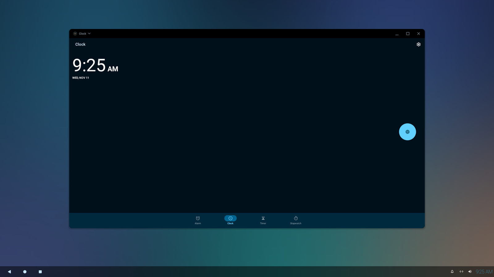
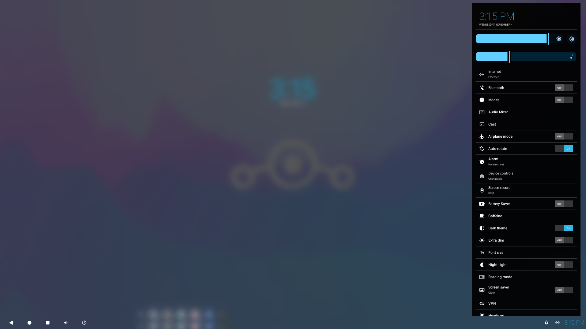
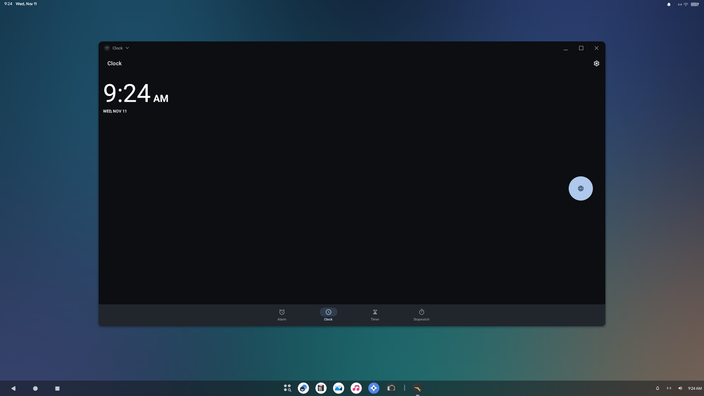
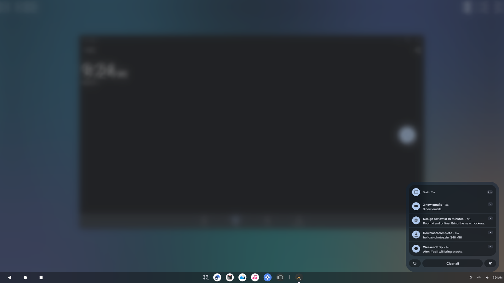

# retro-style

A theme engine with styles from every Android era, plus a tablet system bar, for large-screen
Android 16 builds (LineageOS 23.2), packaged as one `vendor/retro-style` repo you can drop into a
source tree.

| KitKat style, tablet system bar | KitKat Quick Settings |
|---|---|
|  |  |
| **Material You, tablet system bar** | **Material You notifications** |
|  |  |

What you get, all switchable at runtime in **Settings > System > UI style**:

- **Theme packs:** 18 to start with. Today's Material You and Material 3; Android through the
  years (Froyo, Gingerbread, Honeycomb, Jelly Bean, KitKat, Holo Light, Lollipop, Pie); and ROM
  classics (Pitch Black, Glass, Mono, and the Nord, Dracula, Solarized, Gruvbox and Catppuccin
  palettes). A pack sets the palette, dark mode, fonts, corner shapes, the widget family (Holo,
  classic or Material 1 widgets), icons and the shade and bar colors.
- **Made for designers:** a pack is one `theme.json` plus optional resources.
  `tools/theme_tool.py` generates the rest and checks the pack, and
  [docs/THEME_SPEC.md](docs/THEME_SPEC.md) is the rulebook. New packs show up in Settings with no
  code change.
- **Tablet system bar:** one bottom bar laid out like Android 3.x/4.x tablets: back, home and
  recents (plus optional volume, screenshot and sleep buttons) on the left, your apps and tasks in
  the middle, and a tray with notifications, status icons, network, battery, volume and the clock
  on the right. Works with every pack.
- **Dual Shade panels:** Notifications and Quick Settings as floating panels that open from the
  top right or from the tray at the bottom right. Dual Shade itself comes from
  [vendor/dual-shade](../dual-shade), which retro-style requires.
- **Session kept:** changing a style restarts SystemUI; your open desktop windows come back where
  they were.

It is meant for large screens (tablets, desktops, x86 PCs) with desktop windowing. Phones are not
a target.

This repo is also meant as a worked example of how to extend an Android ROM: runtime resource
overlays, a privileged platform app, and patch series for frameworks/base and Launcher3
(dual-shade adds aconfig flags set at build time). The docs explain each piece as they go.

## Requirements

- A LineageOS 23.2 tree (Android 16 QPR2, release `bp4a`). Other AOSP-based Android 16 trees work
  too if their `frameworks/base` and `Launcher3` match closely enough for the patches.
- [vendor/dual-shade](../dual-shade), for the floating panels.
- A large-screen device (smallest width 600dp or more), ideally with desktop windowing on.
- The device's platform key (the build signs RetroStyle with it).

## Quick start

1. Put this repo at `vendor/retro-style` and dual-shade at `vendor/dual-shade`
   ([docs/INSTALL.md](docs/INSTALL.md#1-get-the-repo)).
2. Apply both repos' patches: `vendor/dual-shade/tools/apply-patches.sh apply` and
   `vendor/retro-style/tools/apply-patches.sh apply` ([what they do](docs/PATCHES.md)).
3. Inherit the product makefile in your device makefile:
   ```make
   RETRO_STYLE_TYPE := kitkat   # optional default pack: any id in themes/ (default: material)
   $(call inherit-product, vendor/retro-style/retro_style.mk)
   ```
4. Build as usual (`breakfast <device> && m bacon`).
5. On the device, open **Settings > System > UI style**.

[docs/INSTALL.md](docs/INSTALL.md) walks through every step, with checks and troubleshooting.

## Repo layout

| Path | What it is |
|---|---|
| `retro_style.mk` | Product makefile to inherit; build defaults and the packages to install |
| `RetroStyle/` | The UI style page and the code that applies a style (system app; Soong and Gradle builds) |
| `themes/` | Theme packs (`themes/<id>/theme.json` and their overlays), the template, the JSON Schema and the generated `themes.mk` |
| `overlays/` | Layout overlay: the tablet system bar |
| `patches/` | `git format-patch` series for `frameworks/base` (SystemUI) and `packages/apps/Launcher3` |
| `tools/` | `theme_tool.py` (create, generate and check packs), `apply-patches.sh`, an overlay test builder |
| `tests/` | `retro_style_matrix.sh`, an on-device bug hunt over every option combination and pack |
| `assets/` | The AOSP 4.x artwork and fonts the Holo packs use, with their sources |
| `docs/` | Install guide, how it works, the theme spec, the patches, testing, and the user guide |

## Docs

- [INSTALL.md](docs/INSTALL.md): add it to a tree, step by step
- [HOW_IT_WORKS.md](docs/HOW_IT_WORKS.md): the moving parts and why they're built this way
- [THEME_SPEC.md](docs/THEME_SPEC.md): how to design a theme pack (start from
  [themes/_template](themes/_template/README.md))
- [PATCHES.md](docs/PATCHES.md): what each patch changes, and how to maintain the series
- [TESTING.md](docs/TESTING.md): quick checks, on-device tests, the matrix
- [USER_GUIDE.md](docs/USER_GUIDE.md): the Settings page, for users

## License

Copyright (C) 2026 Navotpala Tech (Bliss Co-Labs Inc.). retro-style is dual-licensed:

- **GNU Affero General Public License v3.0** (`LICENSE`): free for open-source ROMs and projects
  that meet its terms, such as publishing the source of what they ship.
- **Commercial license** (`LICENSE_COMMERCIAL`): for companies that want to ship it without the
  AGPL's obligations. Contact info@navotpala.tech.

The Android 4.x artwork and fonts from AOSP, and the AOSP files the patches change, stay under the
Apache License 2.0. [LICENSING.md](LICENSING.md) says which parts are which, and `NOTICE` holds
the attributions.
