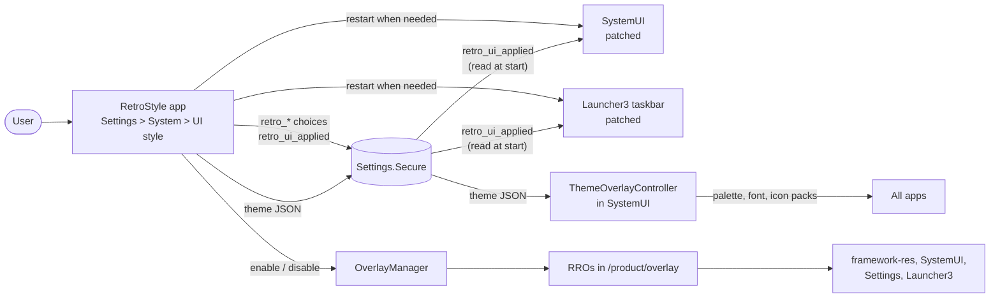

# How retro-style works

retro-style changes the look of the whole OS without forking it. It combines five standard
Android mechanisms, and each one is worth knowing on its own:

1. **Runtime resource overlays (RROs)** replace resources (styles, dimensions, drawables,
   colors) in other packages without touching their code.
2. **SystemUI's theme JSON** turns a seed color, a font and icon packs into overlays for every app.
3. **aconfig flags set at build time** turn on SystemUI features that are off in the release.
4. **A privileged platform app** stores the user's choices and switches all of the above.
5. **Small patch series** add what resources alone can't: new layouts in SystemUI and the
   taskbar.



## 1. Runtime resource overlays

An RRO is an APK with only resources and a manifest naming its target:

```xml
<overlay android:targetPackage="com.android.launcher3" android:category="org.retro.style" />
```

When it's enabled, the target sees the overlay's resources instead of its own wherever the names
match. The KitKat pack uses this to:

- re-parent `Widget.DeviceDefault.*` styles in `framework-res` to their Holo versions
  (`overlays/KitKatFramework/res/values/styles.xml`, generated by `tools/gen_holo_widgets.py`), so
  every app built on DeviceDefault widgets turns Holo;
- square the corner radii in framework-res, SystemUI and Settings (`dimens.xml` files);
- swap navigation and tray icons in Launcher3 (`overlays/KitKatLauncher3/res/drawable*`).

Two rules decide what an overlay may touch:

- **Where it's installed.** The overlays here are `product_specific: true`, so they land in
  `/product/overlay`. Overlays on system partitions are trusted more than ones installed later.
- **What the target allows.** A target can declare `<overlayable>` resources and policies. Targets
  without any declaration (framework-res, SystemUI, Settings and Launcher3 today) accept any
  overlay from a system partition or signed with the same key. That's why these overlays only
  work when built into the image; installing them later with `adb install` fails for Launcher3.

Overlays with `android:isStatic="true"` (the Dual Shade config) are always on. The others start
disabled, and RetroStyle switches them through `OverlayManager`.

## 2. The theme JSON

SystemUI's `ThemeOverlayController` watches the secure setting
`theme_customization_overlay_packages`, a small JSON object. From a seed color and a style it
builds Material You's color palette for every app (Monet), and it enables the font and icon pack
overlays the JSON names. This is what the stock Wallpaper & style picker writes too.

RetroStyle writes:

| Style | Theme JSON |
|---|---|
| KitKat | seed `#33B5E5` (Holo blue), `VIBRANT`, font `org.retro.style.kitkat.font`, icon packs `org.retro.style.kitkat.icons.*` |
| Material 3 | seed `#6750A4` (the Material 3 baseline), `TONAL_SPOT` |
| Material You | the user's own JSON, saved in `retro_ui_style_saved_theme` before the first switch |

During the setup wizard, SystemUI writes hardware color defaults over this JSON. RetroStyle
schedules a job (`SetupCompleteJob`) that writes the style's JSON again once
`user_setup_complete` turns 1.

## 3. Dual Shade and aconfig

Dual Shade (separate floating Notifications and Quick Settings panels) is SystemUI's newer shade,
built on its "scene container". It's behind two aconfig flags, `scene_container` and
`status_bar_for_desktop`, which are off in the `bp4a` release.

aconfig flags get their values from the release config. `config/aconfig/` sets both flags:

- `*_flag_values.textproto`: one value per flag
- `Android.bp`: `aconfig_values` and an `aconfig_value_set` that groups them
- `release_config_map.textproto` and `release_configs/bp4a.textproto`: add the value set to the
  `bp4a` release
- `retro_style.mk`: `PRODUCT_RELEASE_CONFIG_MAPS` adds the map to your product

Values set at build time work everywhere. On-device overrides (`aflags`, `device_config`) need
the `aconfigd` service and a `/metadata` partition, which not every device has (x86 images don't).

Turning on the scene container exposes some unfinished parts of AOSP. Patches 0004, 0005 and 0007
fix the ones we hit: stuck heads-up notifications, the shade window swallowing taps, and a
lockscreen crash loop ([PATCHES.md](PATCHES.md)).

## 4. The RetroStyle app

`RetroStyle/` is a privileged system app signed with the platform key and running as the system
user (`android:sharedUserId="android.uid.system"`). That's what lets it switch other packages'
overlays (`CHANGE_OVERLAY_PACKAGES`), write secure settings, restart SystemUI and the launcher
(`KILL_UID`), and list other apps' windows (`REAL_GET_TASKS`).

| Source | Job |
|---|---|
| `StyleSettings.kt` | The user's choices (`retro_*` secure settings) and their defaults |
| `StyleApplier.kt` | Resolves the choices, writes `retro_ui_applied`, switches overlays, writes the theme JSON, restarts what needs restarting |
| `WindowSession.kt` | Saves and reopens desktop windows around a SystemUI restart |
| `ApplyWorker.kt` | Runs applies off the main thread; boot, adb/test and setup-complete entry points |
| `StyleActivity.kt` | The Settings page; themed after the chosen style |
| `Hidden.kt` | The few hidden framework calls, through reflection (see below) |

### Why a secure setting and not system properties

SystemUI and Launcher3 need to know the applied style when they start. A system property would
be the obvious channel, but on SELinux-enforcing builds an app can't set a custom `persist.*`
property without new SELinux policy. Secure settings need no policy: RetroStyle writes the
resolved style to one setting, `retro_ui_applied`
(`style=kitkat;variant=kitkat_stock;layout=system_bar;anchor=bottom_end;bar_apps=0;...`), and
SystemUI and Launcher3 each read it once through a small `RetroUiApplied` helper the patches add.
Reading a read-only build property (`ro.retro.ui_style.default`) is allowed for every app, so the
build defaults stay properties.

### Why SystemUI and the launcher restart

Both read the applied style once per process, as Android does for most configuration. When a
value they use changes (KitKat on or off, the panel anchor, the status bar overlay, the bar
layout or its options), RetroStyle kills the process and Android restarts it: SystemUI because
it's persistent, the launcher because it's home.

### Keeping the user's windows

On large screens with desktop windowing, desktop windows live in root tasks that WM Shell
creates, and WM Shell runs inside SystemUI. When SystemUI dies, WindowManager removes those tasks
and closes every desktop window. `WindowSession` lists the visible desktop windows (component and
bounds) before the restart, waits for the new SystemUI and a few seconds for WM Shell to set the
desktop up again, then reopens each window at its old bounds (`ActivityOptions.setLaunchBounds`).
Apps reopen at their main screen; the UI style page reopens on itself.

### Hidden APIs and two builds

Soong builds the app with `platform_apis: true`, which can call hidden framework APIs directly.
The repo also has a Gradle build (`RetroStyle/`, `./gradlew :app:assembleRelease`) for quick
iteration, which only sees the public SDK. To keep one source for both, the handful of hidden
calls (`OverlayManager.setEnabled`, `ActivityManager.killUid`, a task's window bounds) go through
reflection in `Hidden.kt`. Platform-signed apps are exempt from hidden API restrictions, so this
works on the device. `app/hidden-api-stub` gives the Gradle build `android.os.SystemProperties`.

## 5. The patches

Resources can't add a layout that doesn't exist, so SystemUI and the taskbar get small patch
series. They're kept as `git format-patch` files so you can read them, apply them with `git am`,
and regenerate them from commits. [PATCHES.md](PATCHES.md) goes through each one.
